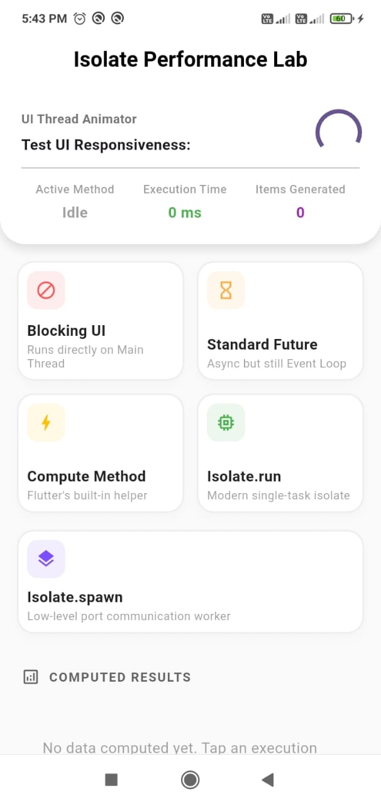
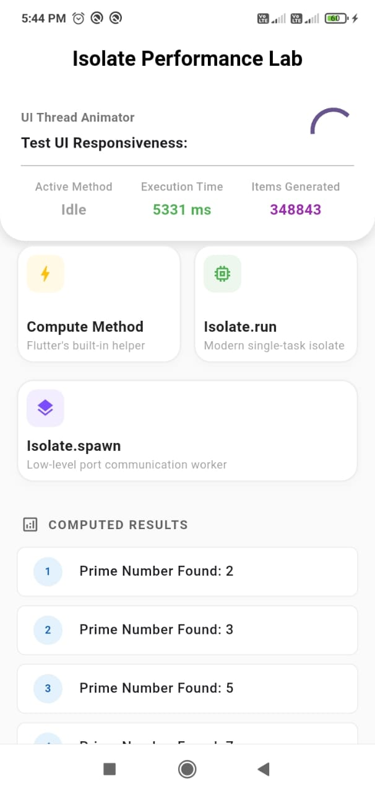

# ⚡ Flutter Isolate Performance Lab

A high-performance Flutter demonstration application designed to benchmark and visualize multi-threading behavior in Dart. This project implements five distinct computation paradigms to highlight how intensive mathematical operations impact the Main UI Thread, providing clear visual metrics on when to offload tasks to background threads.

## 🎯 Project Purpose

In Flutter, long-running processes (like heavy math, JSON parsing, or image manipulation) run on a single main thread by default. If a task takes too long, it causes **jank** (dropped frames) and freezes the UI.

This app calculates **5,000,000 prime numbers** using different asynchronous and multi-threaded strategies, measuring the exact execution duration in milliseconds while tracking UI responsiveness via an active loading indicator.

---

## 🚀 Execution Models Benchmarked

### 1. 🛑 Blocking UI (Synchronous Execution)

* **How it works:** Runs directly on the Main UI Thread.
* **UI Impact:** **Severe Freezing.** The circular progress indicator completely locks up until the math finishes because the event loop is blocked.

### 2. ⏳ Standard Future (`async/await`)

* **How it works:** Schedules a task on Dart's event queue.
* **UI Impact:** **Still Freezing.** Many developers mistakenly think `Future` equals a new thread. Because it remains on the main isolate, intensive calculations will still freeze the UI animation.

### 3. ⚡ Compute Method (`compute()`)

* **How it works:** Flutter's built-in utility helper that spawns a short-lived isolate behind the scenes and destroys it automatically.
* **UI Impact:** **Perfectly Smooth.** The UI stays 100% responsive because the math is offloaded to a separate CPU core.

### 4. 🧠 Isolate.run()

* **How it works:** Introduced in Dart 2.19, this is the modern, streamlined way to execute single-shot functions on a separate background thread without manual port setup.
* **UI Impact:** **Perfectly Smooth.** Provides low overhead and keeps the frame rate perfectly fluid.

### 5. 🏗️ Isolate.spawn()

* **How it works:** Low-level, explicit thread management using two-way communication channels (`ReceivePort` and `SendPort`). Ideal for persistent, long-running background worker configurations.
* **UI Impact:** **Perfectly Smooth.** Optimal architecture for continuous stream processing or repetitive heavy tasks.

---

## 🛠️ Architecture & UI Highlights

* **Sliver-Based Performance Dashboard:** Built completely on a unified `CustomScrollView` using `SliverGrid` and `SliverList` layout rules for optimal rendering memory footprint.
* **Real-time Metrics Panel:** Captures execution time dynamically via the native Dart `Stopwatch` API.
* **Granular State Indicators:** Independent state-tracking logic ensuring only the actively computing model exhibits a loader, disabling parallel trigger actions during operations.
* **Modular UI Components:** High-fidelity, self-contained widgets structured according to industry production standards.

---

## 📸 Screenshots

| Dashboard Overview | Active Thread Execution Metrics |
| :---: | :---: |
|  |  |

---

## 🏃 Getting Started

### Prerequisites

* Flutter SDK (Latest Stable Version recommended)
* Dart SDK

### Installation

1. Clone the repository:

   ```bash
   git clone https://github.com/aniketmmaind/flutter_isolate_demo
   ```

2. Navigate into the project folder:

   ```bash
   cd flutter_isolate_demo
   ```

3. Fetch packages:

   ```bash
   flutter pub get
   ```

4. Run the project:

   ```bash
   flutter run
   ```

---

## 📝 Concepts Demonstrated

* Multi-core concurrency in Dart/Flutter.
* Advanced layout engineering via `CustomScrollView` and Slivers.
* State management best practices during asynchronous bottlenecks.
* Performance diagnostic benchmarking using the `Stopwatch` utility class.
